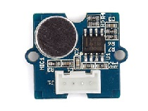

# Sensors

## Grove Sound Sensor

- [Documentation officielle](https://wiki.seeedstudio.com/Grove-Sound_Sensor/)
- [Schéma électronique v1.6](grove_sound_sensor_v1.6_schema.pdf)

Ce capteur fournit une sortie analogique représentant l'intensité sonore. Il
est utilisé dans l'exercice 4 pour détecter les pics de la musique.
