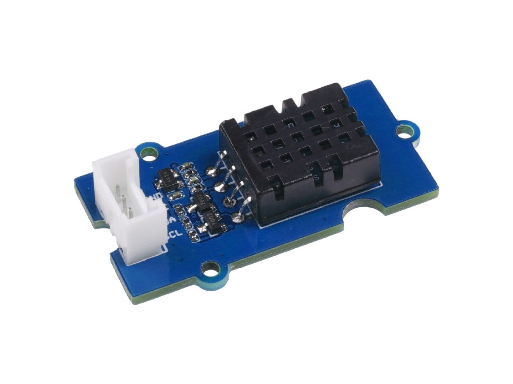
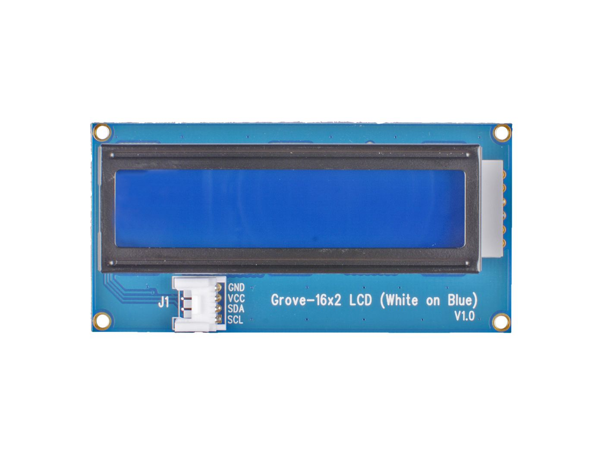
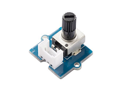
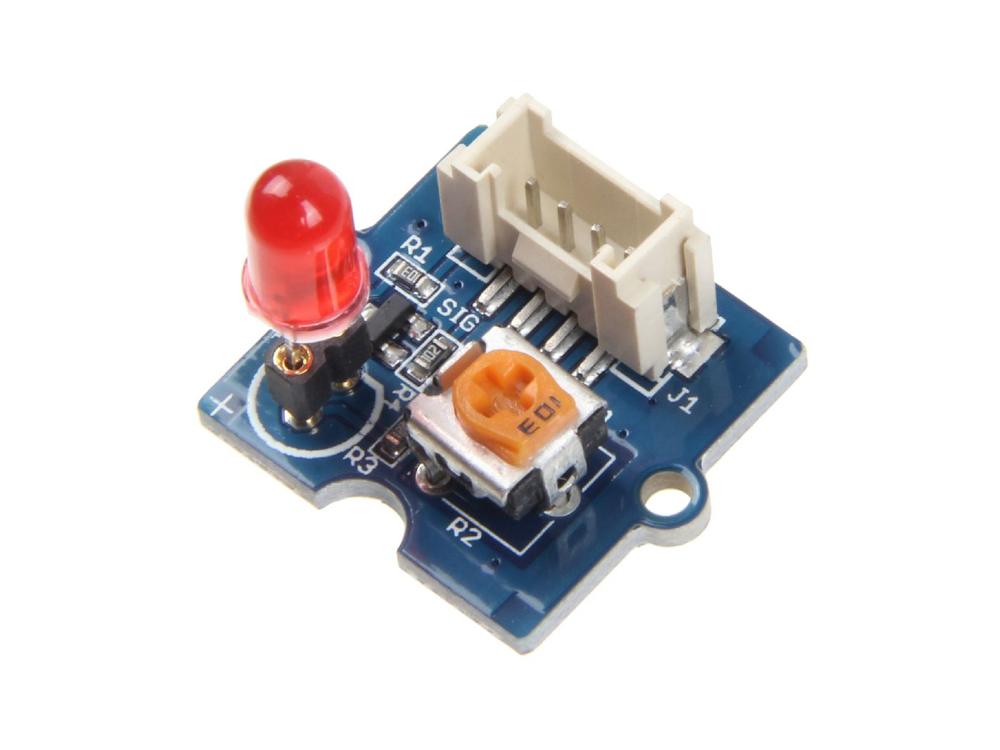
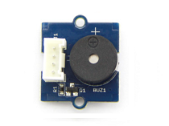

# Exercice 3 — Système de contrôle de température

## Objectif

Ce projet MicroPython utilise un **Raspberry Pi Pico 2 W** pour réaliser un
thermostat simple. Un potentiomètre permet de choisir une température de
consigne comprise entre **15 °C et 35 °C**, tandis qu'un Temperature Sensor
DHT20 mesure la température ambiante.

Le programme compare les deux températures, affiche les valeurs sur un écran
LCD1602 et avertit l'utilisateur avec une LED et un buzzer lorsque la
température devient trop élevée.

## Matériel utilisé

### Raspberry Pi Pico 2 W


### Temperature Sensor Grove — DHT20



### Écran Grove LCD1602 — 16 × 2



### Module potentiomètre Grove



### Module LED Grove — Socket V1.7



### Module buzzer Grove



## Branchement

| Composant | Broche ou bus du Pico | Mode |
|---|---|---|
| Potentiomètre | GPIO 26 | Entrée analogique ADC |
| Buzzer | GPIO 27 | Sortie PWM |
| LED | GPIO 18 | Sortie PWM à 1 kHz |
| Écran LCD1602 | I2C1 — SDA GPIO 6, SCL GPIO 7 | I2C, adresse `0x3E` |
| Temperature Sensor DHT20 | I2C0 — SDA GPIO 8, SCL GPIO 9 | I2C, adresse `0x38` |

Les broches sont configurées dans `constants/pin.py`. Les paramètres du LCD et
du Temperature Sensor se trouvent respectivement dans `constants/screen.py` et
`constants/temp_sensor.py`.

L'écran et le capteur utilisent deux bus différents : le LCD est sur **I2C1**
et le DHT20 sur **I2C0**. Cela permet aux deux modules de communiquer sans
partager les mêmes broches SDA et SCL.

## Organisation du code

> **NB à moi-même : faire un schéma de développement.**

```text
Exercice3/
├── assets/
│   └── Exercice3-1.pdf       # cahier des charges
├── constants/
│   ├── constants.py          # plage de température et valeur maximale ADC
│   ├── pin.py                # configuration des GPIO, de l'ADC et du PWM
│   ├── screen.py             # configuration I2C du LCD1602
│   └── temp_sensor.py        # configuration I2C du DHT20
├── drivers/
│   ├── buzzer.py             # contrôle du buzzer et de son alarme
│   ├── lcd.py                # écriture sur l'écran
│   ├── led.py                # contrôle de la LED
│   └── potentiometer.py      # lecture de la température de consigne
├── library/
│   ├── dht20.py              # communication avec le Temperature Sensor
│   └── lcd1602.py            # communication avec l'écran LCD
├── services/
│   ├── screen_service.py      # affichage normal et animations de l'alarme
│   ├── temperature_service.py # logique séparée, non utilisée dans main.py
│   └── timer.py               # temporisations
├── main.py                   # point d'entrée du programme
└── README.md
```

Cette séparation permet de ne pas mélanger la configuration matérielle, les
pilotes des composants et la logique principale du thermostat.

## Fonctionnement

Le fichier `main.py` est organisé autour de deux fonctions :

1. `setup()` crée le potentiomètre, l'écran, le timer, la LED et le buzzer ;
2. `loop()` lit les températures, appelle `handleTemperature()` et actualise
   l'écran lorsque l'alarme n'est pas active.

### Température de consigne

Le potentiomètre renvoie une valeur ADC comprise entre `0` et `65535`. Cette
valeur est convertie dans une plage de **15 °C à 35 °C** :

```python
temperature = 15 + (valeur_adc / 65535) * 20
```

Le résultat est arrondi afin d'obtenir une température de consigne simple à
lire et à comparer.

### Comparaison des températures

Le thermostat possède trois états :

| Condition | LED | Buzzer | Écran LCD |
|---|---|---|---|
| Température ambiante ≤ consigne | Pas d'alerte | Éteint | Températures affichées |
| Température ambiante > consigne | Clignotement à 0,5 Hz | Éteint | Températures affichées |
| Température ambiante > consigne + 3 °C | Clignotement plus rapide | Alarme sonore | Message `ALARM` |

Une fréquence de **0,5 Hz** correspond à une période complète de deux
secondes. La LED doit donc changer d'état toutes les secondes : une seconde
allumée, puis une seconde éteinte.

### Affichage

L'écran LCD possède deux lignes de seize caractères. Il sert à afficher :

```text
Set: 22 C
Ambient: 24 C
```

`Set` correspond à la température choisie avec le potentiomètre et `Ambient`
à la température mesurée par le Temperature Sensor. Lorsque l'écart dépasse
3 °C, le mot `ALARM` est également affiché.

### Alarme sonore

Lorsque la température ambiante dépasse la consigne de plus de 3 °C, le buzzer
sonne à une fréquence de `2500 Hz`. Dès que l'écart ne dépasse plus 3 °C,
l'alarme sonore s'arrête.

## Effets bonus

La LED est contrôlée en PWM. La méthode `dimmer()` augmente puis diminue
progressivement son rapport cyclique entre `0` et `65535`, ce qui produit un
effet de battement lumineux pendant l'alarme.

Le fichier `services/screen_service.py` contient également deux animations
pour le mot `ALARM` :

- le mode `1` fait clignoter le mot sur l'écran ;
- le mode `2` affiche progressivement les lettres `A`, `L`, `A`, `R`, `M`.

Le mode utilisé est choisi avec la constante `MODE` dans
`constants/constants.py`.

## Communication I2C

Le protocole I2C utilise deux lignes :

- `SDA` transporte les données ;
- `SCL` fournit le signal d'horloge.

Le Pico agit comme maître et les modules répondent comme esclaves à leur
adresse. Le Temperature Sensor DHT20 utilise l'adresse `0x38`, tandis que
l'écran LCD répond à l'adresse `0x3E`.

## Problème rencontré

J'ai rencontré un problème avec l'I2C : un canal semblait à la fois occupé et
non utilisé. Cela donnait l'impression que la LED et l'écran étaient branchés
sur les mêmes broches ou que les modules utilisaient tous les deux `I2C0`,
alors que la configuration prévoyait deux bus séparés.

Je n'ai pas vraiment compris l'origine exacte du problème. La communication
avec l'écran produisait une erreur d'entrée/sortie et les modules ne
répondaient plus normalement. Après avoir redémarré le Raspberry Pi Pico, les
bus I2C ont de nouveau fonctionné correctement.

## Références du matériel

- [Grove Basic Kit for Raspberry Pi Pico](https://wiki.seeedstudio.com/Grove-Starter-Kit-for-Raspberry-Pi-Pico/)
- [Grove 16 × 2 LCD](https://wiki.seeedstudio.com/Grove-16x2_LCD_Series/)
- [Grove Temperature & Humidity Sensor DHT20](https://wiki.seeedstudio.com/Grove-Temperature-Humidity-Sensor-DH20/)
