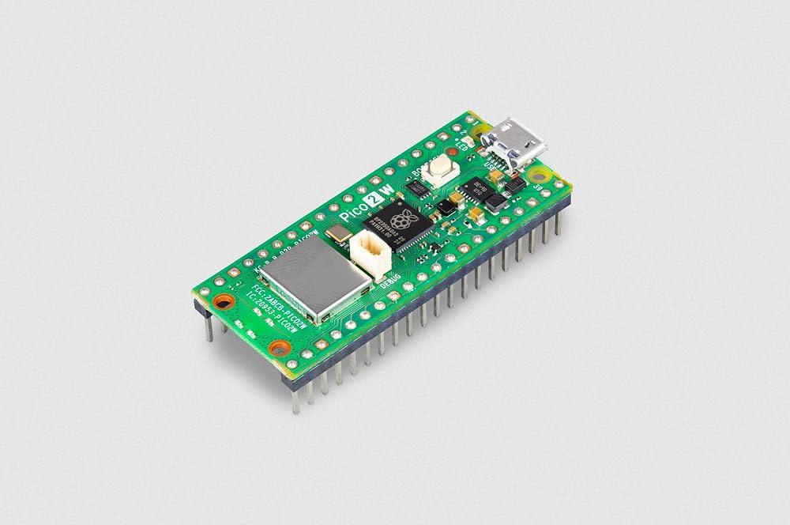
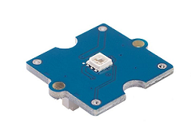

# Exercice 4 — Contrôle d'une LED RGB au rythme de la musique

## Objectif

Ce projet MicroPython utilise un **Raspberry Pi Pico 2 W**, un capteur sonore et
une LED RGB. Le programme mesure continuellement l'intensité sonore et change
la couleur de la LED lorsqu'un pic sonore est détecté.

Chaque nouvelle couleur est choisie aléatoirement afin de produire un effet
lumineux synchronisé avec le rythme de la musique.

## Matériel utilisé

### Raspberry Pi Pico 2 W



### Module Grove Sound Sensor


### Module Grove RGB LED — WS2813 Mini



## Branchement

| Composant | Broche du Pico | Mode |
|---|---:|---|
| Capteur sonore | GPIO 27 — ADC1 | Entrée analogique |
| LED RGB WS2813 Mini | GPIO 18 | Sortie numérique |

Les broches utilisées sont configurées dans `constants/pin.py`. Le capteur
sonore est lu avec l'ADC et la LED reçoit ses données sur une sortie numérique.


## Organisation du code

```text
Exercice4/
├── assets/
│   ├── Exercice4.pdf          # énoncé de l'exercice
│   └── Paragraphe Loop.loop   # document de travail
├── constants/
│   ├── colors.py              # couleurs disponibles
│   ├── led.py                 # création de la LED WS2813 Mini
│   └── pin.py                 # configuration des broches
├── drivers/
│   ├── led.py                 # contrôle de la couleur de la LED
│   └── soundSensor.py         # mesure de l'intensité sonore
├── library/
│   ├── dht11.py               # bibliothèque non utilisée dans main.py
│   ├── dht20.py               # bibliothèque non utilisée dans main.py
│   ├── lcd1602.py             # bibliothèque non utilisée dans main.py
│   └── ws2812.py              # communication avec la LED RGB
├── services/
│   └── timer.py               # mesure du temps
├── main.py                    # point d'entrée du programme
└── README.md
```

Cette séparation permet de ne pas mélanger la configuration matérielle, le
pilotage des composants et la logique de l'application.

## Fonctionnement

Le fichier `main.py` est organisé autour de deux fonctions :

1. `setup()` crée le timer, la LED RGB et le capteur sonore ;
2. `loop()` mesure continuellement le son et change la couleur de la LED
   lorsqu'un pic est détecté.

### Mesure du son

La méthode `read_sound()` lit le capteur pendant une fenêtre de **30 ms** et
conserve la valeur la plus élevée :

```python
while self.timer.ticks_diff(self.timer.ticks_ms(), start) < 30:
    value = self.pin.read_u16() / 256
    max_sound = max(max_sound, value)
```

La lecture ADC, initialement comprise entre `0` et `65535`, est divisée par
`256`. Le programme travaille ainsi avec une valeur comprise approximativement
entre `0` et `255`.

### Détection d'un battement

Le seuil de détection est fixé à `20` :

```python
threshold = 20
```

Une mesure supérieure à ce seuil est considérée comme un pic sonore. Deux
changements de couleur doivent également être espacés d'au moins **150 ms**.
Cette limite empêche un même pic de provoquer plusieurs changements trop
rapprochés.

### Changement de couleur

Lorsqu'un pic valide est détecté, une couleur est choisie aléatoirement dans
la liste `COLORS` :

```python
led.set_color(choice(COLORS))
```

Les couleurs disponibles sont le rouge, le jaune, le vert, le cyan, le bleu,
le violet et le blanc. En l'absence d'un nouveau pic, la LED conserve sa
dernière couleur.

## Bonus

Le calcul du rythme en BPM ainsi que l'enregistrement de la moyenne des BPM
dans un fichier texte ne sont pas implémentés dans la version actuelle.

## Problème rencontré
